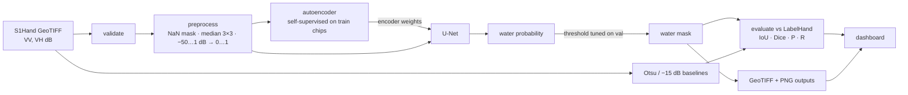

# SAR Surface-Water Mapping on Sen1Floods11

Per-pixel detection of open surface water in Sentinel-1 radar imagery, with an
autoencoder-pretrained U-Net, classical threshold baselines, leakage-safe evaluation and a Flask
dashboard. Repository name and history: *Spatio-Temporal Analysis of SAR Imagery Using
Autoencoder-Based Feature Learning for Flood-Prone Area Detection* (see
[What changed](#what-changed-from-the-original-project) for why the scope is now stated more
narrowly).

> **Status.** The code, tests and dashboard run end to end. **No model has been trained on the
> real Sen1Floods11 data yet** (the dataset could not be downloaded where this version was built),
> so this README reports no real-data accuracy. Follow [Reproduce](#reproduce-on-sen1floods11) to
> produce one; every number the project shows is read from files those commands write.

## Why

Floods usually come with cloud cover, which blinds optical satellites. Synthetic Aperture Radar
(SAR) images the ground through cloud, day and night. Calm water acts like a mirror and reflects
the radar pulse away from the satellite, so it appears as the darkest pixels in the image (roughly
−20 dB VV against −10 dB for land). Turning that into reliable water maps is harder than it sounds:
speckle noise, radar shadow, smooth tarmac and sand look like water, while flooded vegetation and
streets look brighter than water. This project measures how much a learned model adds over the
simple thresholds used operationally.

## Features

- **Data validation** for Sen1Floods11 (pairing, corrupt files, label values, NaN/inf no-data,
  georeferencing) with a JSON report.
- **One preprocessing path** for training, evaluation and inference: NaN-aware 3×3 median
  despeckling and fixed-range dB scaling that keeps absolute backscatter.
- **Autoencoder pre-training → U-Net segmentation** on VV + VH, masked BCE + Dice loss that
  ignores no-data and unlabelled pixels.
- **Leakage-safe protocol**: official splits or whole-event group splits, autoencoder trained on
  training images only, checkpoint and threshold chosen on validation only, test touched only by
  `evaluate`; the split is saved with every run.
- **Baselines in every evaluation**: per-chip Otsu and a fixed −15 dB VV threshold.
- **Metrics** with an ignore index: IoU, Dice/F1, precision, recall, pixel accuracy (micro and
  per-chip, with empty chips handled explicitly) written as JSON + CSV.
- **Outputs** as georeferenced mask GeoTIFFs and PNG quick-looks (VV, VH, false colour, overlay,
  agreement map).
- **Dashboard**: upload a GeoTIFF or pick a sample; an analysis page with KPIs, a class
  breakdown, image comparison, spatial grid and map; a PDF report; evaluation results.
- **Legacy model preserved**: the original MobileNetV2 + transformer classifier, made loadable on
  current Python and reported with its correct meaning.
- **83 tests** on synthetic fixtures and a GitHub Actions workflow.

## Architecture



More detail, including the training sequence and dashboard request flow, is in
[docs/ARCHITECTURE.md](docs/ARCHITECTURE.md).

## Repository layout

```text
├── app.py                     # `python app.py` → dashboard
├── configs/                   # default.yaml (real data), smoke.yaml (synthetic, minutes on CPU)
├── src/sar_flood/
│   ├── config.py, cli.py, utils.py
│   ├── data/                  # Sen1Floods11 discovery, splits, validation, synthetic data, loader
│   ├── preprocessing/         # the single preprocessing path
│   ├── models/                # unet.py (AE + U-Net + losses), legacy.py (original classifier)
│   ├── training/              # trainer.py
│   ├── evaluation/            # metrics, baselines, evaluate
│   ├── inference/             # Segmenter, single-file analysis pipeline
│   ├── visualization/         # quick-looks, GeoTIFF export
│   └── web/                   # Flask app, templates, static
├── models/legacy/             # three original Keras models (tracked)
├── samples/                   # synthetic demo chips + the original uploads
├── notebooks/                 # original Colab notebooks (historical, see notebooks/README.md)
├── scripts/                   # make_demo_samples.py
├── tests/                     # pytest suite (no dataset needed)
└── docs/                      # audit, architecture, dataset, model card, installation, portfolio
```

## Installation

```bash
git clone https://github.com/ishajainbtech24-oss/Spatio-temporal-sar-analysis.git
cd Spatio-temporal-sar-analysis
python3 -m venv .venv && source .venv/bin/activate      # Windows: .venv\Scripts\Activate.ps1
pip install -e ".[ml,dev]"
pytest                                                    # ~20 s, no dataset needed
```

Windows, GPU and TensorFlow-free installs are covered in
[docs/INSTALLATION.md](docs/INSTALLATION.md).

## Quick start (no dataset, ~1 minute on CPU)

```bash
sar-flood make-synthetic --out data/synthetic            # synthetic chips in Sen1Floods11 format
sar-flood validate-data --config configs/smoke.yaml
sar-flood train --config configs/smoke.yaml              # AE pre-train + U-Net
sar-flood evaluate --config configs/smoke.yaml --run-dir outputs/runs/smoke_synthetic
sar-flood predict samples/synthetic/Synthetic_Foxtrot_1000_S1Hand.tif \
    --label samples/synthetic/Synthetic_Foxtrot_1000_LabelHand.tif \
    --run-dir outputs/runs/smoke_synthetic --out outputs/predictions/demo
sar-flood serve                                          # http://127.0.0.1:5000
```

This proves the pipeline works. Synthetic water is trivially separable, so the metrics it prints
are not results; the dashboard labels synthetic-trained checkpoints as such.

## Reproduce on Sen1Floods11

1. Download the hand-labelled chips and split files ([docs/DATASET.md](docs/DATASET.md)):
   ```bash
   gsutil -m rsync -r gs://sen1floods11/v1.1/data/flood_events/HandLabeled data/raw/sen1floods11/v1.1/data/flood_events/HandLabeled
   gsutil -m rsync -r gs://sen1floods11/v1.1/splits data/raw/sen1floods11/v1.1/splits
   ```
2. Validate, train, evaluate:
   ```bash
   sar-flood validate-data                                  # uses configs/default.yaml
   sar-flood train --config configs/default.yaml
   sar-flood evaluate --config configs/default.yaml \
       --run-dir outputs/runs/unet_sen1floods11 --split test --legacy
   ```
3. Results land in `outputs/eval/unet_sen1floods11_test/` (`metrics.json`, per-chip CSVs) and
   appear on the dashboard's Evaluation page. To score the baselines without training, drop
   `--run-dir`.

Useful switches: `--epochs`, `--ae-epochs`, `--max-train-samples`, `--device cpu|gpu`,
`--data-root` (or `SAR_DATA_ROOT`). For an ablation without autoencoder initialisation set
`train.use_autoencoder_init: false` in a copied config.

### Inputs and outputs

| Command | Input | Output |
|---|---|---|
| `validate-data` | dataset root | `outputs/data_validation.json` |
| `train` | dataset root, config | `outputs/runs/<run>/` — `model.keras`, `autoencoder.keras`, `config.yaml`, `splits.json`, `metadata.json`, `history.csv` |
| `evaluate` | run dir (optional), split | `outputs/eval/<run>_<split>/metrics.json`, `per_image_*.csv` |
| `predict` | `*_S1Hand.tif` (or PNG/JPEG), optional label | PNG quick-looks, `*_mask.tif` (1 water, 0 not, 255 no data), `result.json` |

## Results

### Verified in this repository

| What | How it was checked |
|---|---|
| Rebuilt legacy model matches the original | Same 7 inputs through the original file (Python 3.12) and the rebuilt model (Python 3.13): max abs difference 1.25 × 10⁻⁶ |
| Full pipeline runs and learns | `sar-flood train --config configs/smoke.yaml --epochs 15 --ae-epochs 3` on synthetic data (2 CPU cores, 19.5 s of training): validation IoU 0.990; test IoU 0.985 for the U-Net vs. 0.997 for Otsu. Identical on a repeat run (fixed seed). Shows the code works; says nothing about real SAR. |
| Test suite | 83 passed (Python 3.13, TF 2.21); 71 passed / 12 skipped without TensorFlow (Python 3.12) |

### Real-data accuracy

Not available yet — see the status note at the top. Once you run the commands above, record the
U-Net and both baselines from `metrics.json` here and in `docs/MODEL_CARD.md`.

### Historical (original notebooks, not reproduced)

Notebook 07 reported out-of-fold ROC AUC 0.757 (fine-tuned) and 0.723 (frozen) for a chip-level
classifier under 5-fold group cross-validation. Its positive class turned out to be "chip
contains **no** water" because of a label-encoding bug, so these are not flood-detection scores.
Details: [docs/PROJECT_AUDIT.md](docs/PROJECT_AUDIT.md).

## Dashboard

```bash
sar-flood serve              # or: python app.py
```

| Page | What it shows |
|---|---|
| Overview | What the system does, which checkpoint is loaded and what data it was trained on |
| Analyse a chip | Upload a GeoTIFF/PNG (optional ground truth) or pick a bundled sample |
| Result | Analysis dashboard: run ID, status and timestamp; a method switcher (U-Net / Otsu / fixed threshold); KPI strip (water-covered %, not-water %, valid pixels, water pixels, method and run time); land-classification doughnut and prediction summary with pixel counts and — for georeferenced inputs — area in ha/km²; SAR / mask / overlay (opacity slider) / ground-truth comparison with full-size viewer; spatial water-share grid; map; collapsible technical details; **Download report** (PDF) |
| Evaluation | Tables from `outputs/eval/*/metrics.json`, plus clearly separated historical numbers |

With no trained checkpoint, the dashboard runs the baselines and says so. Set
`SAR_FLOOD_RUN_DIR` to choose a run. Uploads are type- and size-checked (default 25 MB), stored
under server-chosen names, and errors are shown as plain messages.

Screenshots: none are included yet, because none could be captured in the build environment.
Add your own to `docs/images/` once the dashboard is running on your machine.

## What changed from the original project

The audit ([docs/PROJECT_AUDIT.md](docs/PROJECT_AUDIT.md)) found, among other things:

1. **Inverted labels** — `LabelEncoder` mapped "Flood"→0, "NoFlood"→1 and later code treated 1 as
   flood, so the deployed model answered "is this chip dry?".
2. **NaN handling** — one no-data pixel turned the whole chip into NaN; 45 such chips were later
   deleted as "corrupted".
3. **Leakage** — a classifier evaluated on its own training features; test sets used as
   validation; the deployed model trained on all data.
4. **Model would not load** on Python 3.13 (pickled `Lambda` → segfault).
5. **Dashboard showed fabricated numbers** (data volumes, alerts, satellite passes).

The new version keeps the notebooks, the three saved models and the autoencoder idea, and moves
the task to what the labels support: **per-pixel water segmentation**. Nothing in Sen1Floods11's
hand-labelled set is time-indexed, so nothing here is claimed to be spatio-temporal.

## Limitations

- No real-data training or evaluation has been run yet (data access).
- Labels include permanent water: outputs are water maps, not flood maps.
- 446 chips from 11 events; performance will vary strongly by region and land cover.
- Known SAR confusions: radar shadow, smooth surfaces, flooded vegetation, urban flooding,
  wind-roughened water.
- Single-date only; no change detection.
- Not validated for operational or emergency use.

## Future work

- Train and report the U-Net vs. baselines on the official test split and the held-out Bolivia
  event; add the no-pretraining ablation.
- Subtract `JRCWaterHand` permanent water to report flood-only IoU.
- Pre-/post-event change detection with a second Sentinel-1 acquisition — the step that would make
  the project genuinely temporal.
- Use the larger weakly-labelled Sen1Floods11 set for pre-training.
- Calibrate probabilities and report precision at fixed false-alarm rates.

## References

- Bonafilia, D., Tellman, B., Anderson, T., Issenberg, E. (2020). *Sen1Floods11: a georeferenced
  dataset to train and test deep learning flood algorithms for Sentinel-1.* CVPR Workshops,
  210–211. Data: <https://github.com/cloudtostreet/Sen1Floods11>
- Ronneberger, O., Fischer, P., Brox, T. (2015). *U-Net: Convolutional Networks for Biomedical
  Image Segmentation.* MICCAI.
- Otsu, N. (1979). *A threshold selection method from gray-level histograms.* IEEE Trans. SMC.

## Author and licence

Isha Jain (B.Tech Data Science, RV University), per the repository's commit history. See
[CITATION.cff](CITATION.cff).

**No licence file has been added** — the original repository had none, and choosing one is the
author's decision. Until a licence is added, default copyright applies. The Sen1Floods11 data is
distributed separately under its own terms (listed as CC BY 4.0 on dataset mirrors).

Further docs: [installation](docs/INSTALLATION.md) · [dataset](docs/DATASET.md) ·
[architecture](docs/ARCHITECTURE.md) · [model card](docs/MODEL_CARD.md) ·
[audit](docs/PROJECT_AUDIT.md) · [portfolio notes](docs/PORTFOLIO.md) ·
[changelog](CHANGELOG.md) · [contributing](CONTRIBUTING.md)
