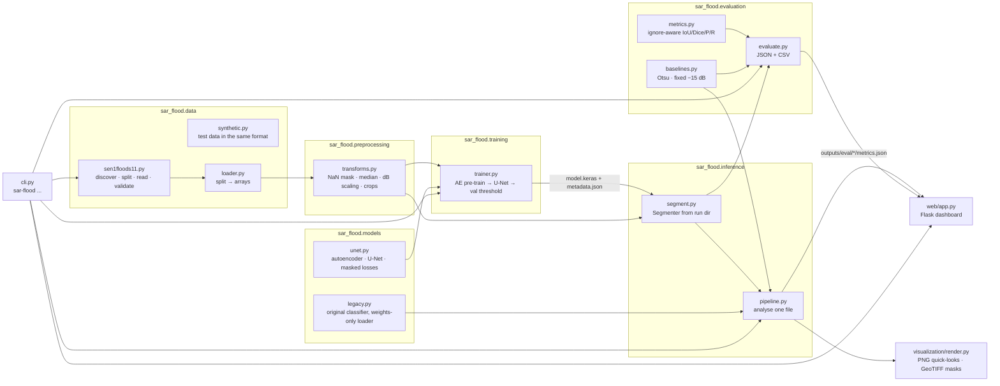
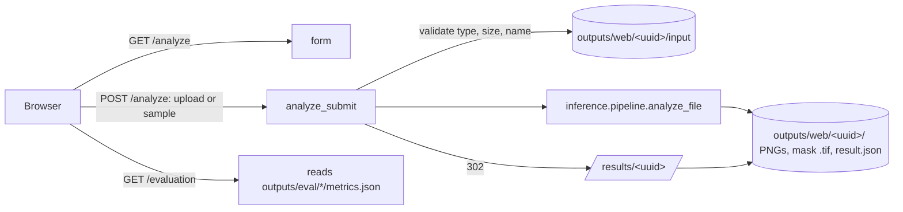

# Architecture

## Components



`preprocessing.transforms.preprocess_chip` is the only place where SAR values are transformed.
Training, validation, evaluation and inference all call it, using the configuration stored with
the run (`config.yaml`), so they cannot drift apart.

## Data flow for one training run

```mermaid
sequenceDiagram
  participant CLI as sar-flood train
  participant DS as data
  participant AE as autoencoder
  participant UN as U-Net
  participant FS as outputs/runs/<run>
  CLI->>FS: config.yaml
  CLI->>DS: discover pairs, make splits (official or by event)
  DS->>FS: splits.json
  DS->>CLI: train + val arrays (test is not loaded)
  CLI->>AE: fit on random crops of TRAIN images (reconstruction, masked MSE)
  AE->>UN: copy enc*/bott* weights
  CLI->>UN: fit on crops; validate on full VAL chips; keep best val IoU
  UN->>FS: model.keras, history.csv
  CLI->>UN: sweep threshold on VAL pixels (max IoU)
  CLI->>FS: metadata.json (threshold, val metrics, versions, timings)
```

## Model

**U-Net** (`build_unet`): depth 4, base 16 filters (1.95 M parameters at defaults; the autoencoder has 1.77 M), blocks of
2 × (Conv3×3 → BatchNorm → ReLU), max-pool down, transposed-conv up with skip connections,
spatial dropout at the bottleneck, sigmoid output = per-pixel water probability. Fully
convolutional, so any input whose sides are multiples of 16 works; inference pads and crops.

**Autoencoder** (`build_autoencoder`): the same encoder and bottleneck (identical layer names)
plus a decoder without skips (a U-Net with skips could copy the input and learn nothing).
Trained to reconstruct VV/VH on training crops, ignoring no-data pixels. Its encoder weights
initialise the U-Net. `train.use_autoencoder_init: false` trains from scratch for an ablation.

**Loss**: binary cross-entropy + soft Dice, both computed only over pixels with label 0/1. Dice
counters the class imbalance (most pixels are not water) without hand-tuned class weights.

**Inputs**: 2 channels (VV, VH), scaled from a fixed −50…1 dB range. The fixed range preserves
absolute backscatter, which is the main physical signal for open water.

### Design decisions

| Decision | Why |
|---|---|
| Segmentation, not chip classification | The labels are per-pixel masks; collapsing them threw away information and produced the inverted-label bug. IoU on water pixels is the standard Sen1Floods11 metric. |
| VV + VH | VH adds information on vegetation and rough water; the original code read only VV. |
| Autoencoder kept as pre-training | Preserves the project's feature-learning idea, and lets it use unlabelled pixels, without a separate classifier on flattened features. |
| No `Lambda` / custom layers | Saved models load across Python and Keras versions (the old model segfaulted). |
| Classical baselines in every evaluation | A thresholded VV image is the operational default; a model must beat it. |
| Threshold tuned on validation | Probabilities are not calibrated; 0.5 is arbitrary. The test set stays untouched. |
| Keras/TensorFlow kept | The existing models and notebooks are Keras; switching frameworks would discard them. |

### Not temporal

Every hand-labelled chip is one acquisition. No component uses time series. Extending this to
change detection would need pre-event imagery (for example the Sen1Floods11 weakly-labelled set
or a separate Sentinel-1 search) — see the README's future work.

## Legacy model

`models/legacy/simple_transformer_pretrained_final.keras` (notebook 07) is kept and loaded by
`models/legacy.py`, which rebuilds the graph and loads only the weights. Its output is reported as
*probability the chip contains no labelled water* (see `PROJECT_AUDIT.md` §3.1). The two
autoencoder-pipeline models (`encoder.keras`, `simple_transformer_final.keras`) load with Keras
directly but are not used, because no evaluation of them survives in the notebooks.

## Dashboard



* Results page: `web/results.py` turns `result.json` into one view model used by both the HTML
  page and the PDF report (`web/report.py`), so they always show the same numbers. Pixel counts,
  fractions, areas and the spatial grid are computed by `inference/pipeline.py` from the binary
  masks; results from before this was stored are re-counted from the saved mask files.
* Uploads: extension allow-list, `MAX_CONTENT_LENGTH`, server-chosen file names, content is
  parsed by rasterio/OpenCV and rejected with a readable message if invalid.
* Result and file routes accept only a 32-hex id and plain file names (no path traversal).
* Errors are logged server-side; users see a short message, never a traceback or a path.
* The U-Net is optional: with no checkpoint the dashboard runs the baselines and says so.
* The map view appears only for georeferenced GeoTIFFs and places the overlay from the file's own
  bounds.
